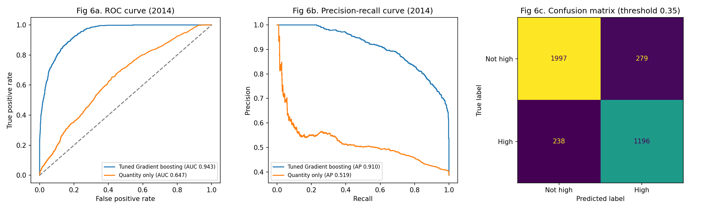
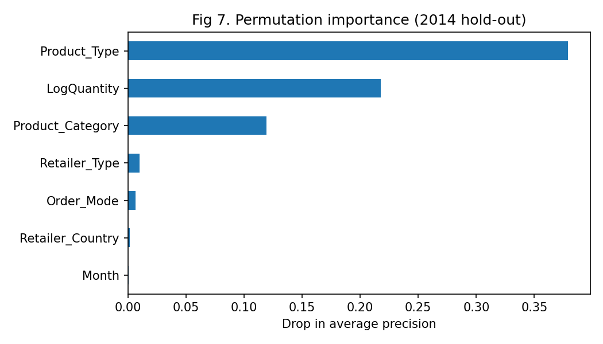

# Predicting High-Value Orders for a Sports-Equipment Wholesaler

Classifies which sales orders will be unusually large, so stock, credit checks and account-manager time can be prioritised. Gradient boosting reaches **AUC 0.94 and F1 0.82 on an unseen year (2014)**.

## Problem
Predict whether an order is **high value**: revenue of at least 39,165, the top quarter of 2012–2013 orders. Gross margin is excluded because it is only known after the sale (Kaufman et al., 2012).

## Data
- 16,063 orders (2012–2014), 5 countries, 8 retailer types, 7 order modes. 
- 147 zero-revenue orders were removed. Train on 2012–2013 and test on 2014, so the model is judged on a future year.

## Approach
1. EDA with statistical tests (chi-square with Cramér's V, Mann-Whitney, Kruskal-Wallis).
2. Compared logistic regression, random forest and gradient boosting using 5-fold CV, on three feature sets: **A** account and channel, **B** + product type and quantity, **C** + exact product.
3. Tuned the best model (gradient boosting) with grid search and chose the decision threshold on out-of-fold predictions.
4. Evaluated on 2014, including by order channel.

## Results (2014 hold-out, 3,710 orders)
| Model | AUC | Precision | Recall | F1 |
|---|---|---|---|---|
| Majority baseline | 0.500 | 0 | 0 | 0 |
| Quantity only | 0.647 | 0.481 | 0.706 | 0.572 |
| **Gradient boosting (threshold 0.35)** | **0.943** | **0.811** | **0.834** | **0.822** |



## Key findings
- **Product type and quantity drive order value** (permutation importance 0.379 and 0.218); country, month and channel add almost nothing.
- **Account and channel alone barely beat chance** (feature set A, AUC about 0.65).
- **Adding the exact product gives near-perfect scores** (AUC about 0.998), but only because revenue is quantity × a fixed price. That is a lookup, so feature set B is the main model.
- **Dataset shift:** average order value rose from about 26,000 (2012) to 47,000 (2014), and the high-value share from 25% to 39%. Orders fell from 6,426 to 3,710 and web grew from 55% to 80% of orders.
- **Weaker outside the web channel:** recall is 87% for web but 63% for sales visits and 57% for e-mail.



## Recommendations
1. Use the model as an order-intake flag (about 81% of flagged orders are high value; 83% of high-value orders are caught).
2. Where the exact product and quantity are known, use price × quantity instead.
3. Retrain at least yearly and monitor drift.
4. Review non-web orders manually, and capture customer IDs so churn modelling becomes possible.

## Limitations
- Only three years of data, with a notable change in 2014.
- The threshold maximises F1 and assumes equal error costs.
- Some channels have few high-value orders, so their recall estimates are uncertain.

## Run it
```bash
pip install -r requirements.txt
python order_value_model.py > results.txt
```
Files: `order_value_model.py` (analysis), `results.txt` (output), `figures/` (plots), `data/` (dataset).
